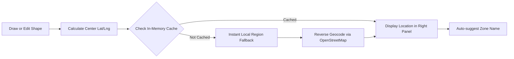

# How Delineation Location Detection Works

When you draw or edit a mangrove delineation on the map, the system automatically detects the real-world place name in **5 simple steps**.

---

## 1. Finding the Center Point (The "Pin Drop")

When you draw a polygon area, a line, or click a point:
- The map collects all the latitude and longitude coordinates along the boundary.
- The system calculates the **geometric center (centroid)** of the shape by taking the average of all the points.

> **Analogy:** If you cut out your drawn mangrove shape from a piece of cardboard, the center point is the exact spot where it would balance on the tip of your finger.

```
       [Point 1] -------- [Point 2]
           \                  /
            \     ★ Center   /
             \   (Lat, Lng) /
          [Point 4] ------ [Point 3]
```

---

## 2. Asking the Map Directory (Reverse Geocoding)

Once the center coordinate `(Latitude, Longitude)` is calculated, the system asks an online global map directory (**OpenStreetMap Nominatim**):

> *"What barangay, municipality, and province is located at these coordinates?"*

The map directory inspects the coordinates and returns the administrative hierarchy:
1. **Local Area / Barangay / Bay:** (e.g., *San Ramon* or *Sogod Bay*)
2. **Municipality / City:** (e.g., *Bontoc* or *Sogod*)
3. **Province:** (e.g., *Southern Leyte*)

The system formats these into a clean, readable name:
> **Location:** `San Ramon, Bontoc, Southern Leyte`

---

## 3. Instant & Offline Backup (Zero-Lag Fallback)

What happens if the internet connection is slow or drops?

The system has a **built-in local map directory** containing coordinate boundaries for all municipalities and coastal bays across Southern Leyte (such as *Sogod Bay*, *Bontoc*, *Sogod*, *Malitbog*, *Padre Burgos*, *Libagon*, *Liloan*, etc.):

- If you are online, it fetches the precise barangay name from OpenStreetMap.
- If offline or while loading, it instantly identifies the municipality or bay using the built-in boundary boxes.
- You never see an error or empty field—there is always an accurate location displayed immediately.

---

## 4. Live Updates When You Edit or Adjust

When you modify the delineation:
- **Dragging Vertices:** In edit mode, dots (handles) appear on each corner of your shape. Dragging any dot updates the shape in real time.
- **On Release (Drag End):** As soon as you let go of a point, the system recalculates the new center point and updates the detected location automatically.
- **Undo / Redo:** Clicking Undo or Redo restores the previous shape and immediately updates both the **Area (ha)** and **Location**.

---

## 5. Smart Caching (Fast & Efficient)

- Once a location is detected for a coordinate area, the system remembers it (**caches** it).
- If you click between different saved zones on the map, the location appears **instantly** without waiting for network requests.
- When you click **Save**, the detected location is saved directly with your delineation so it reloads immediately next time.

---

## Quick Summary Flow


